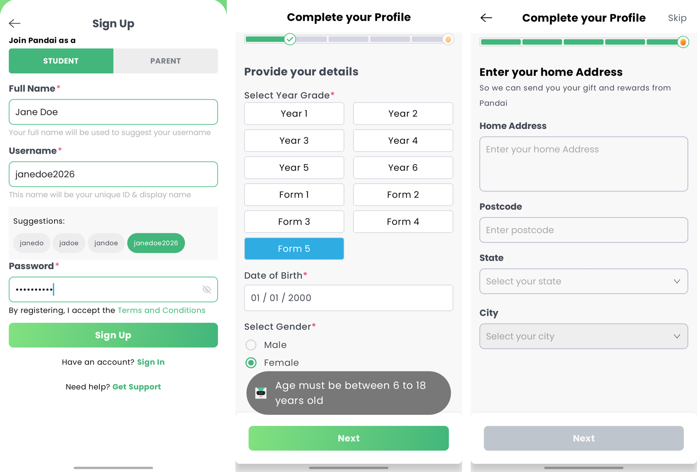
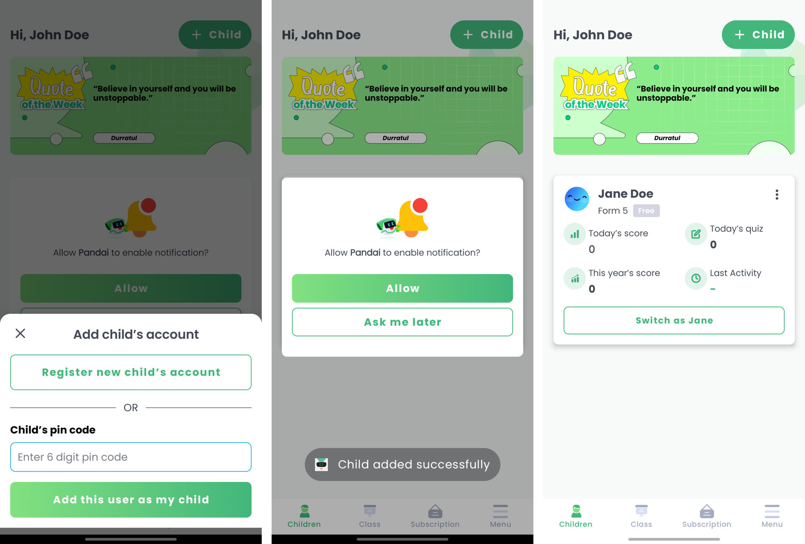
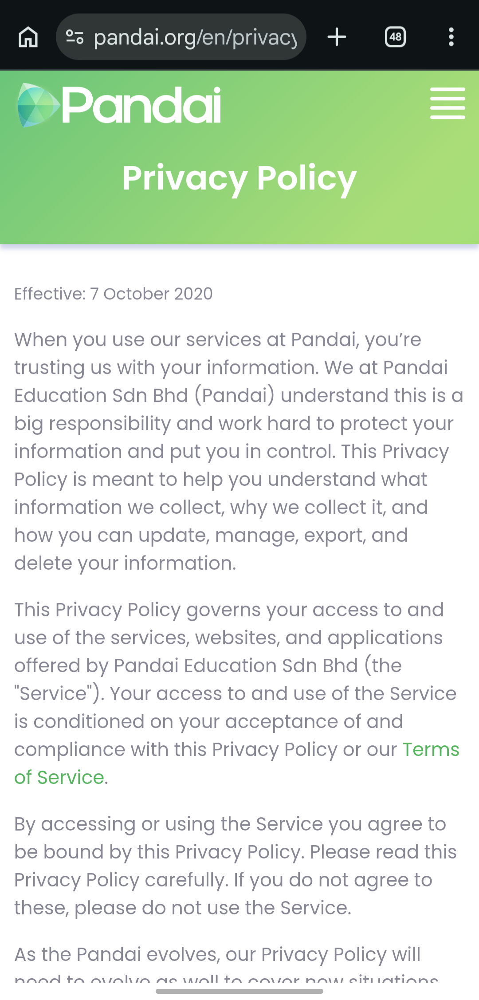
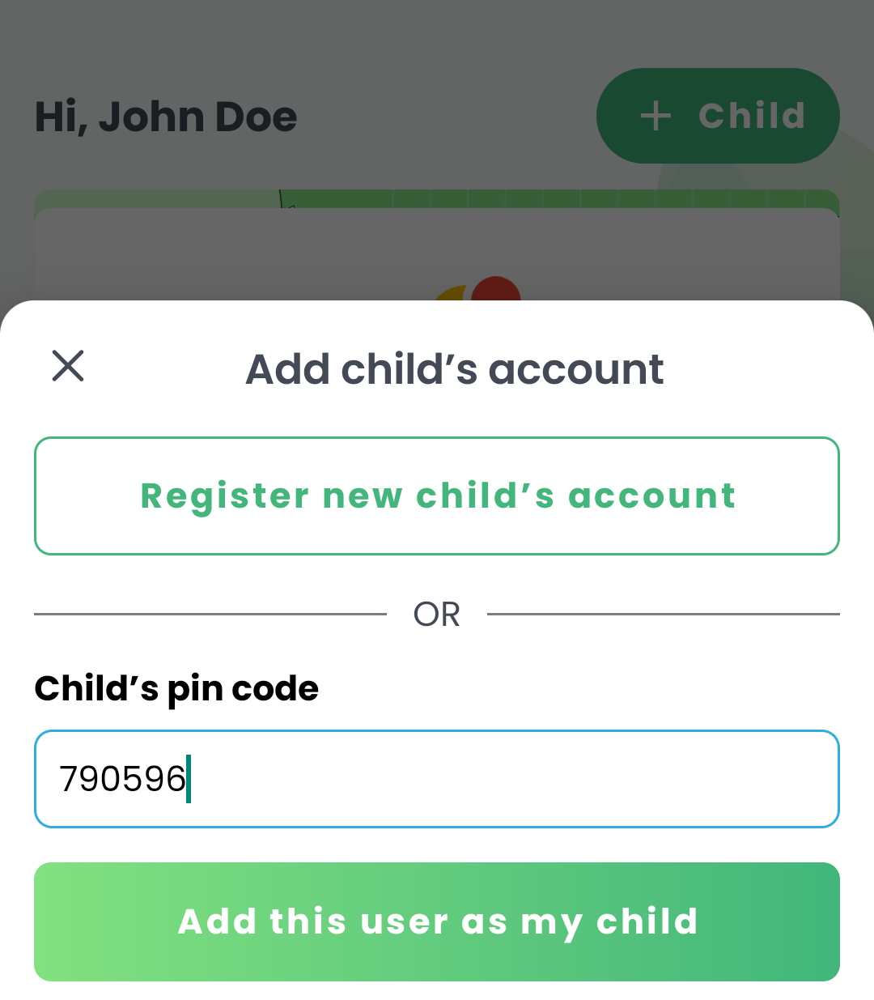
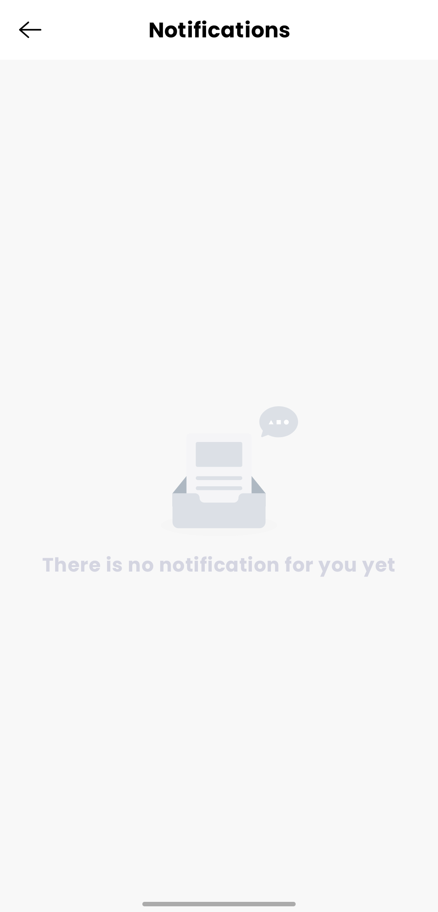
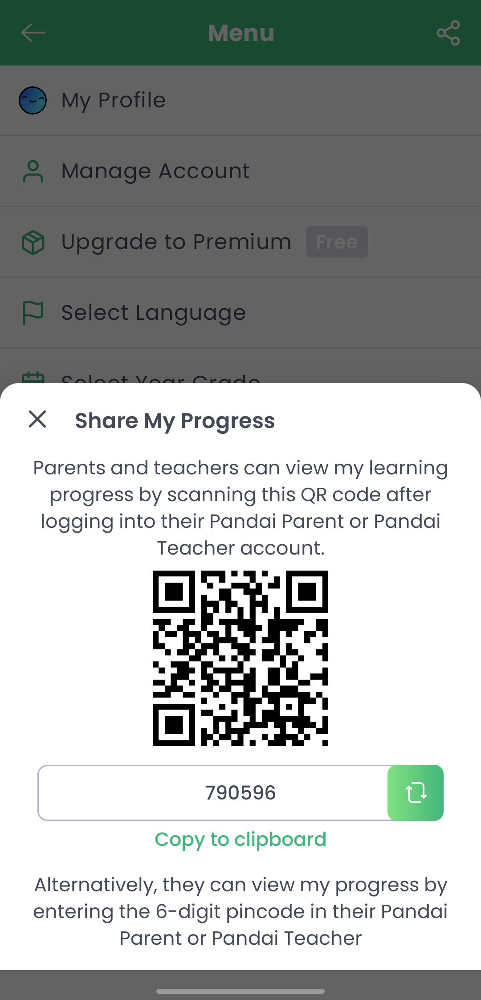
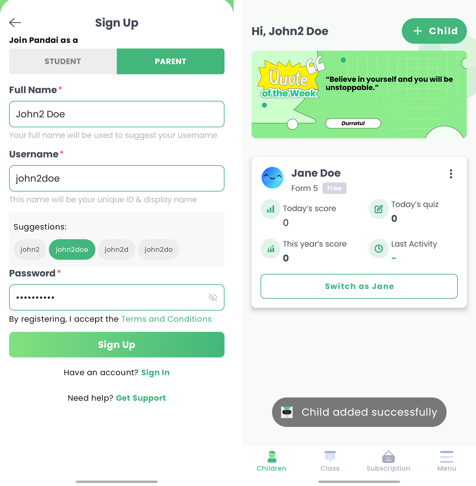
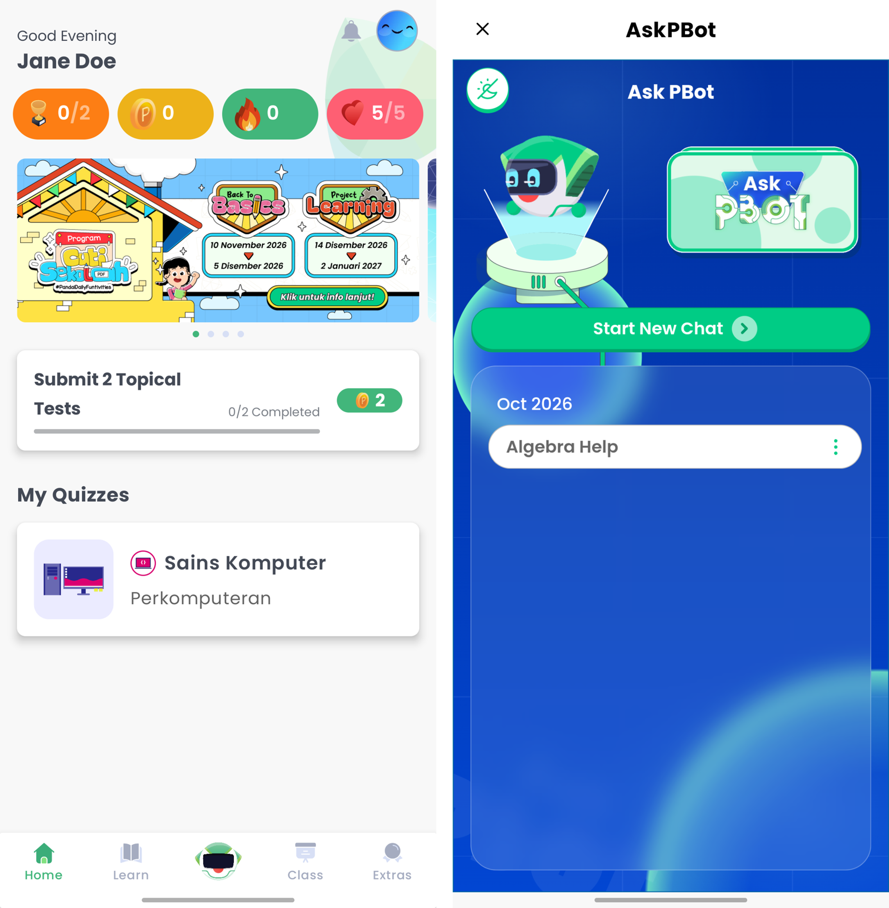
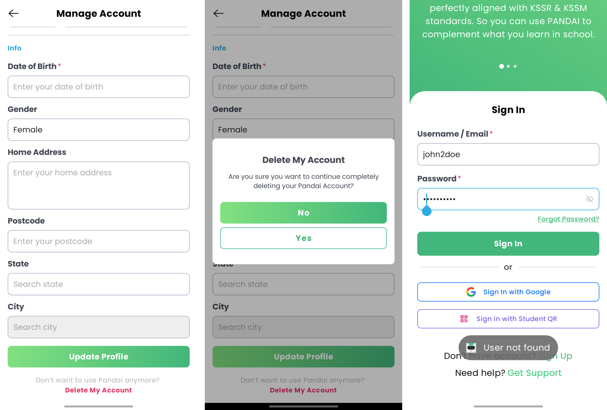

# An Ethical Review of Pandai: Children, Data and Learning in a Malaysian EdTech App

**Module:** COMP3041 Professional Ethics  
**Module Convenor:** Dr. Nabil El Ioini  
**Group:** T  

| Name | Student ID |
|---|---|
|Ong Wei Xuan | 20617520|
|Adrian Lee Joon Yin |20611251 |
|Yumna Akif Ali | 20698295|

---

## 1. Introduction

Pandai is a Malaysian learning app, developed by Pandai Education Sdn Bhd, that 
offers curriculum-aligned quizzes, live tuition, an AI study assistant via Ask Pbot 
and gamified rewards to students from Year 1 to Form 5 (Pandai Education Sdn Bhd, 
n.d.-a). Founded in January 2020, it grew rapidly during pandemic school closures 
(EdTechReview, 2022). It follows a freemium model where a basic version is free, while 
full access requires a monthly Premium subscription (Pandai Education Sdn Bhd, n.d.-b).

Its audience is overwhelmingly young. Three-quarters of its users are primary 
students aged 7 to 12, and around a quarter live in rural areas (MIT Solve, n.d.). 
Parents and teachers are secondary users, with dedicated dashboards for monitoring 
students and setting work.

Pandai is significant in Malaysia for three reasons. First, it operates at scale, 
with the company reporting over one million users (BFM, 2025). Second, it is 
expanding into public education, partnering with the Ministry of Education to 
introduce its AI tools in schools (500 Global, 2025). Third, it has a commercial 
interest in engagement: its CEO has stated an aim to increase daily usage from 
57 to 90 minutes (EdTechReview, 2022). Given its large child user base and its 
interest in their time, Pandai deserves a careful ethical review.

In Part 1, we identified four issues, which are children's data and consent, AI chatbot 
transparency, behaviour shaping through rewards, and inconsistent privacy 
disclosures. This report extends that work with new first-hand evidence, 
evaluates each issue against the Software Engineering Code of Ethics 
(ACM/IEEE-CS, 1999), and applies Kantian deontology and utilitarianism where the 
Code falls short.
### 3.1 Issue 1: Children's Data and Consent

**Claim:** In how it obtains consent for children's data and controls access to 
children's accounts, Pandai breaks Clauses 1.03 and 3.12 of the SE Code 
(ACM/IEEE-CS, 1999), although it largely meets Clause 1.06 by offering working 
account deletion.

**Evidence:** Pandai enforces an age range of 6 to 18 at sign-up, so it knows 
every student user is a minor. Yet consent is implied by registration alone, with 
no parent step (Figure 3.1a).

  

*Figure 3.1a. Student sign-up: (left) consent implied by registering; (middle) 
enforced age range of 6–18; (right) home address request with a Skip option.*

Parent linking is optional and requires only the child's six-digit PIN, after 
which the parent can switch into the child's account (Figure 3.1b).

  

*Figure 3.1b. Parent account: (left) a child is added using only a six-digit PIN; 
(middle) confirmation of the link; (right) dashboard with "Switch as" access to 
the child's account.*

The privacy policy deems any data relating to minors to be given "with the consent 
of the minor's legal guardian", treating the child's registration as that consent. 
It also remains dated 7 October 2020, predating the AI features added since 
(Pandai Education Sdn Bhd, 2020; Figure 3.1c).

  

*Figure 3.1c. Pandai's privacy policy, effective 7 October 2020.*

Our follow-up tests produced five new findings. First, when a parent linked to a 
student account, the student received no notification, and the student profile 
offers no way to see which adults are linked. The student is told only in general 
terms that parents and teachers can view their progress (Figure 3.1d).

  
  
  

*Figure 3.1d. Link test: (left) parent enters the child's PIN; (middle) the 
student's notifications remain empty after linking; (right) the student's only 
information about access is a generic "Share My Progress" notice.*

Second, only the parent can remove a link (Figure 3.1e). The child cannot, because 
they cannot see who is linked.

  

*Figure 3.1e. Only the parent can remove a link: (left) "Remove Child" option; 
(middle) confirmation; (right) child removed.*

Third, a second, unrelated parent account linked to the same student using the 
same PIN, so any number of adults can connect to one child (Figure 3.1f).

  

*Figure 3.1f. A second, unrelated parent account (John2 Doe) links to the same 
student using the same PIN.*

Fourth, switching into the child's account from the parent dashboard opened the 
student's own dashboard, with the same view the child sees after logging in. 
From there, the parent could open the child's Ask Pbot history, including an 
earlier chat the child had started (Figure 3.1g).

  

*Figure 3.1g. After "Switch as Jane": (left) the child's dashboard; (right) the 
child's Ask Pbot chat history, visible to the parent.*

Fifth, both parent and student accounts can be deleted in the app, through 
Manage Account → "Delete My Account". After deletion, the account could no longer 
sign in ("User not found"), and the deleted student no longer appeared on the 
linked parent's dashboard (Figure 3.1h). However, the confirmation message does 
not state which data is deleted, such as quiz results or Ask Pbot chats.

  

  

*Figure 3.1h. Account deletion: (top) a parent account is deleted and can no 
longer sign in; (bottom) the student account offers the same option.*

**Reasoning:** Clause 1.03 requires engineers to approve software only if it does 
not diminish privacy. Deeming a guardian to have consented through a child's 
registration means data from known minors is collected without any adult 
involvement, matching the pattern Reyes et al. (2018) found across child-directed 
apps. We therefore judge this a breach. Clause 3.12 requires software that 
respects the privacy of those it affects. Sign-up collects only a name, username 
and password, but the link tests reveal a more serious gap. Any number of adults 
holding the PIN can link to a child, switch into their account and view their 
Ask Pbot history, while the child receives no notification and cannot see or 
remove those links. This contradicts the policy's own promise to put users "in 
control" of their information (Pandai Education Sdn Bhd, 2020), so we judge 
Clause 3.12 breached. Clause 1.06 requires honesty about software, and here 
Pandai largely meets it: the policy promises that users can delete their 
information, and our test confirmed a working in-app deletion. The confirmation 
message, however, does not explain what is removed, so users cannot verify that 
the promise is fully kept.

**Counterpoint:** Pandai could argue that it minimises data at sign-up, that the 
address request can be skipped, that parental oversight protects children, and 
that its policy references Malaysia's Personal Data Protection Act 2010. 
Oversight by a genuine parent is legitimate, but the system cannot tell a parent 
from any other adult who obtains the PIN. And even if the practice is lawful, 
children understand commercial uses of their data poorly and cannot reliably 
consent for themselves (Livingstone et al., 2019). Legal compliance therefore 
does not remove the ethical responsibility the SE Code places on engineers.