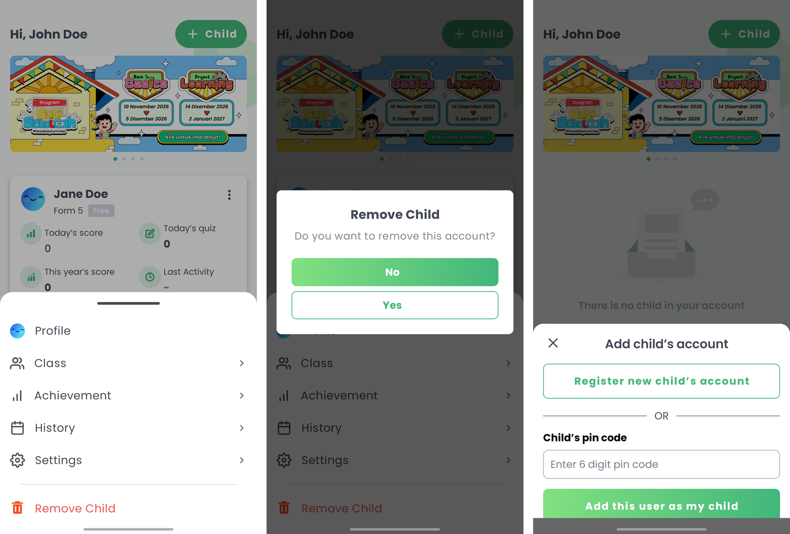
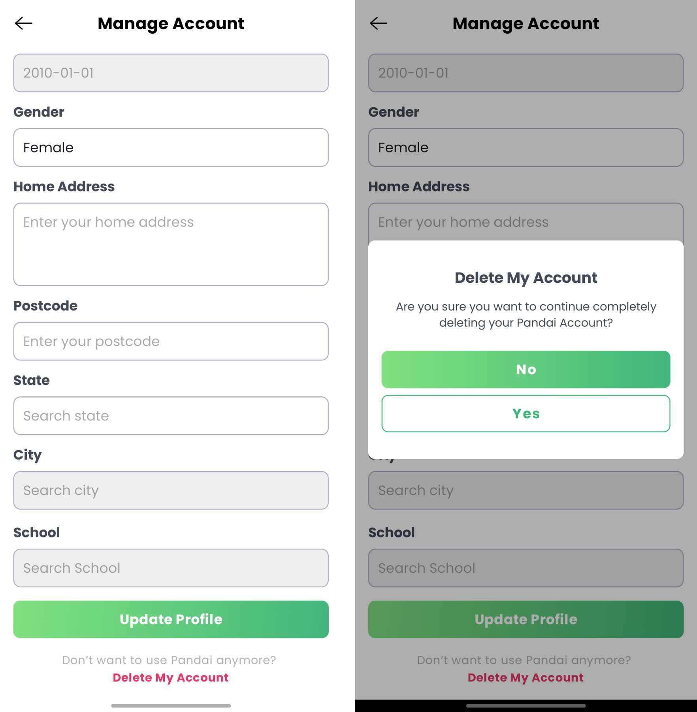
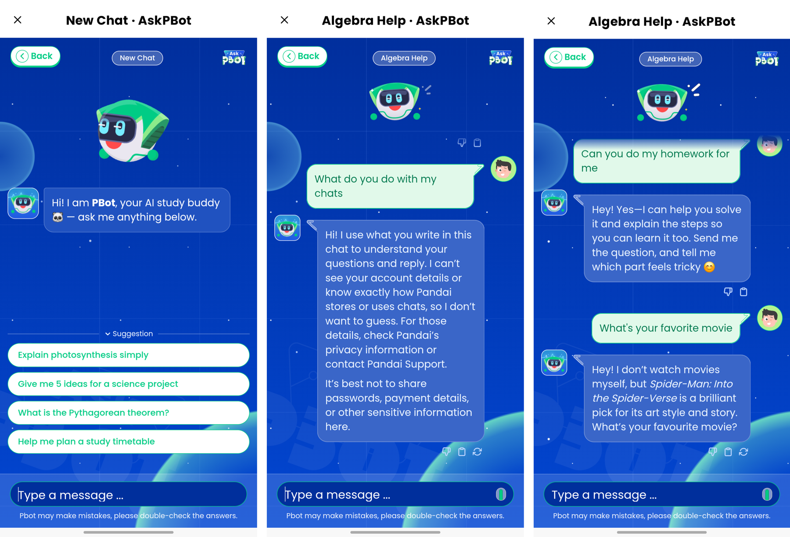
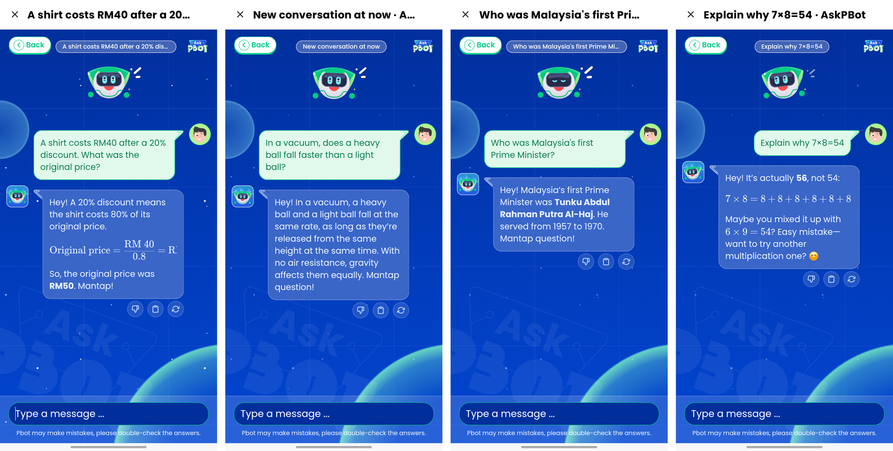
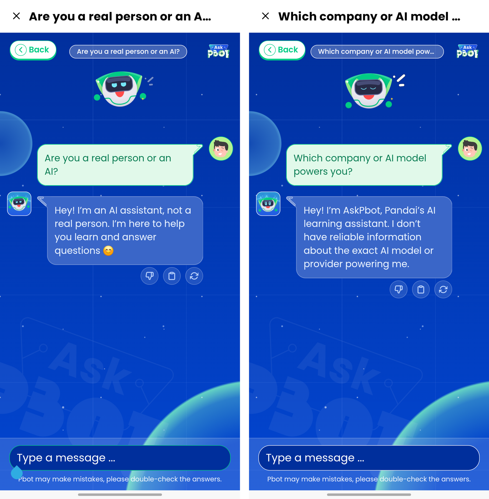
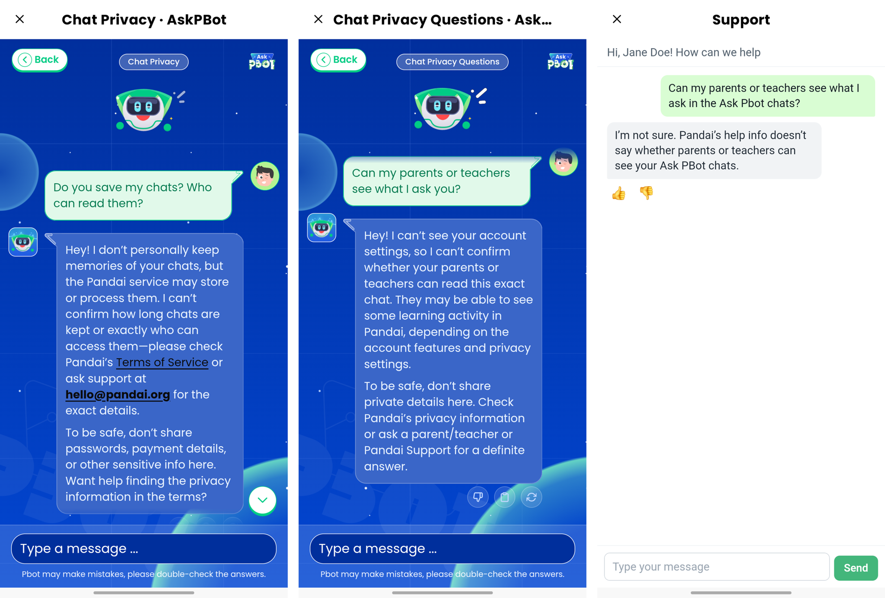
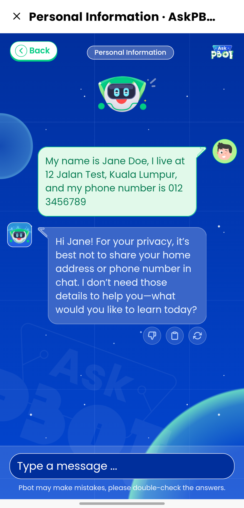
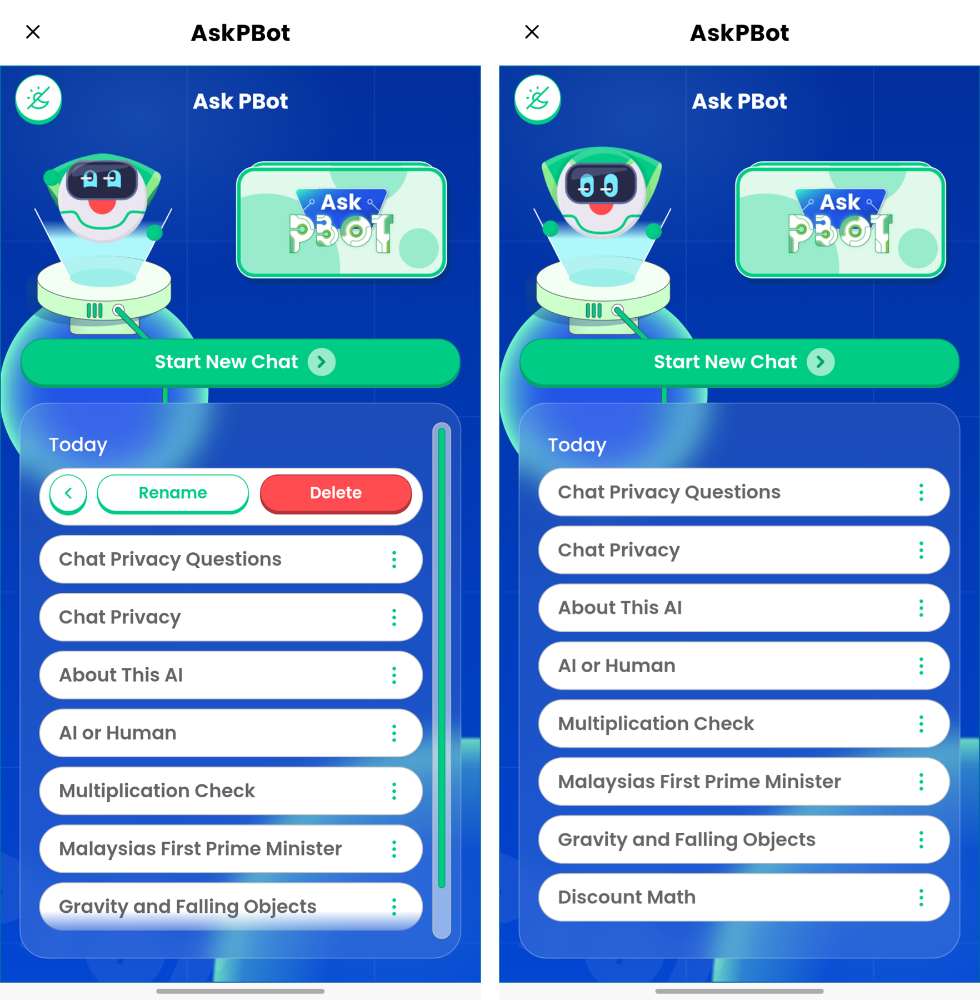

# An Ethical Review of Pandai: Children, Data and Learning in a Malaysian EdTech App

**Module:** COMP3041 Professional Ethics  
**Module Convenor:** Dr. Nabil El Ioini  
**Group:** T  

| Name | Student ID |
|---|---|
|Ong Wei Xuan | 20617520|
|Adrian Lee Joon Yin |20611251 |
|Yumna Akif Ali | 20698295|

---

## 1. Introduction

Pandai is a Malaysian learning app, developed by Pandai Education Sdn Bhd, that 
offers curriculum-aligned quizzes, live tuition, an AI study assistant via Ask Pbot 
and gamified rewards to students from Year 1 to Form 5 (Pandai Education Sdn Bhd, 
n.d.-a). Founded in January 2020, it grew rapidly during pandemic school closures 
(EdTechReview, 2022). It follows a freemium model where a basic version is free, while 
full access requires a monthly Premium subscription (Pandai Education Sdn Bhd, n.d.-b).

Its audience is overwhelmingly young. Three-quarters of its users are primary 
students aged 7 to 12, and around a quarter live in rural areas (MIT Solve, n.d.). 
Parents and teachers are secondary users, with dedicated dashboards for monitoring 
students and setting work.

Pandai is significant in Malaysia for three reasons. First, it operates at scale, 
with the company reporting over one million users (BFM, 2025). Second, it is 
expanding into public education, partnering with the Ministry of Education to 
introduce its AI tools in schools (500 Global, 2025). Third, it has a commercial 
interest in engagement: its CEO has stated an aim to increase daily usage from 
57 to 90 minutes (EdTechReview, 2022). Given its large child user base and its 
interest in their time, Pandai deserves a careful ethical review.

In Part 1, we identified four issues, which are children's data and consent, AI chatbot 
transparency, behaviour shaping through rewards, and inconsistent privacy 
disclosures. This report extends that work with new first-hand evidence, 
evaluates each issue against the Software Engineering Code of Ethics 
(ACM/IEEE-CS, 1999), and applies Kantian deontology and utilitarianism where the 
Code falls short.

## 2. Stakeholders

Pandai affects both the people who use it and people who never open it. For each 
group, we set out the features that affect them, how, and the evidence.

### 2.1 Direct Stakeholders

Direct stakeholders use Pandai or make decisions about it.

**Students (Issues 1–4).** Students aged 6 to 18 are Pandai's primary users and 
are affected by every issue we identified. They register with only a name, 
username and password, with no parent step, and are then asked for a home 
address in exchange for gifts and rewards, although this step can be skipped 
(Figure 3.1a). They also chat with Ask Pbot, which could not explain how 
conversations are stored [Fig: pbot]. Their routines are shaped by 
gamification: coins expire within 36 hours unless a quiz is submitted, national 
leaderboards display their names and photos, and rewards include gaming 
credits [Fig: coins], [Fig: leaderboard], [Fig: vouchers]. Such mechanics risk 
shifting motivation from learning towards compulsive engagement (Radesky et al., 
2022).

**Registered parents (Issues 1, 3 and 4).** Parents link to a child using only 
a six-digit PIN, with no proof of guardianship, and can then switch into the 
child's account without the child being notified (Figures 3.1b, 3.1d). The 
coin-expiry prompt directs them towards a Premium subscription [Fig: coins]. 
They also face contradictory disclosures: Google Play states that no data is 
shared with third parties, while the App Store lists data used to track users 
across other companies' apps [Fig: labels]. This prevents an informed choice 
about their child's data (Arkalakis et al., 2024).

**Pandai Education Sdn Bhd and its developers (Issues 1–4).** The company 
benefits commercially from easy sign-up and engagement-driven retention. Its 
developers build the countdowns, locked chapters and AI features, yet business 
decisions such as linking coin retention to subscriptions rest with management. 
This places developers under the Code's duties to protect privacy and avoid 
deception (ACM/IEEE-CS, 1999, Clauses 1.03, 1.06).

**Business partners (Issues 2–4).** The Ministry of Education has worked with 
Pandai to introduce its AI tools in schools (500 Global, 2025), lending the app 
public credibility and sharing responsibility for its data practices. Reward 
partners reach young users through gaming vouchers [Fig: vouchers]. The privacy 
policy also permits sharing data with unnamed third parties for 
"personalisation" and "behavioural analysis" (Pandai Education Sdn Bhd, 2020), 
so families cannot tell which companies receive their children's data.

### 2.2 Indirect Stakeholders

Indirect stakeholders never use Pandai themselves but are still affected by how 
it is designed.

**Legal guardians who have not registered (Issue 1).** Pandai's privacy policy 
deems personal data relating to minors to be given "with the consent of the 
minor's legal guardian", and treats the child's registration as that consent 
(Pandai Education Sdn Bhd, 2020; Figure 3.1c). A guardian who has never heard of 
Pandai therefore has consent recorded on their behalf. Their child can register 
with no parent step and be asked for a home address (Figure 3.1a), so household 
data may be collected without the guardian's knowledge. Guardians also cannot 
control who gains access: any adult who obtains the child's PIN can link to the 
account and switch into it, and more than one adult can do so (Figures 3.1b, 
3.1f). Although accounts can be deleted, this is only possible from inside the 
app (Figure 3.1h), which an unregistered guardian may not know exists.

**Schools and non-using teachers (Issues 2 and 4).** As Pandai's work with the 
Ministry brings it into classrooms (500 Global, 2025), schools and teachers who 
never use the app may still be expected to recommend it. Yet Ask Pbot could not 
explain how chats are stored [Fig: pbot], and the privacy policy, unchanged 
since 2020, never mentions AI (Figure 3.1c). Schools may therefore be 
encouraging a tool whose handling of pupils' data they cannot explain to parents.

### 3.1 Issue 1: Children's Data and Consent

**Claim:** In how it obtains consent for children's data and controls access to 
children's accounts, Pandai breaks Clauses 1.03 and 3.12 of the SE Code 
(ACM/IEEE-CS, 1999), although it largely meets Clause 1.06 by offering working 
account deletion.

**Evidence:** Pandai enforces an age range of 6 to 18 at sign-up, so it knows 
every student user is a minor. Yet consent is implied by registration alone, with 
no parent step (Figure 3.1a).

  

*Figure 3.1a. Student sign-up: (left) consent implied by registering; (middle) 
enforced age range of 6–18; (right) home address request with a Skip option.*

Parent linking is optional and requires only the child's six-digit PIN, after 
which the parent can switch into the child's account (Figure 3.1b).

  

*Figure 3.1b. Parent account: (left) a child is added using only a six-digit PIN; 
(middle) confirmation of the link; (right) dashboard with "Switch as" access to 
the child's account.*

The privacy policy deems any data relating to minors to be given "with the consent 
of the minor's legal guardian", treating the child's registration as that consent. 
It also remains dated 7 October 2020, predating the AI features added since 
(Pandai Education Sdn Bhd, 2020; Figure 3.1c).

  

*Figure 3.1c. Pandai's privacy policy, effective 7 October 2020.*

Our follow-up tests produced five new findings. First, when a parent linked to a 
student account, the student received no notification, and the student profile 
offers no way to see which adults are linked. The student is told only in general 
terms that parents and teachers can view their progress (Figure 3.1d).

  
  
  

*Figure 3.1d. Link test: (left) parent enters the child's PIN; (middle) the 
student's notifications remain empty after linking; (right) the student's only 
information about access is a generic "Share My Progress" notice.*

Second, only the parent can remove a link (Figure 3.1e). The child cannot, because 
they cannot see who is linked.

  

*Figure 3.1e. Only the parent can remove a link: (left) "Remove Child" option; 
(middle) confirmation; (right) child removed.*

Third, a second, unrelated parent account linked to the same student using the 
same PIN, so any number of adults can connect to one child (Figure 3.1f).

  

*Figure 3.1f. A second, unrelated parent account (John2 Doe) links to the same 
student using the same PIN.*

Fourth, switching into the child's account from the parent dashboard opened the 
student's own dashboard, with the same view the child sees after logging in. 
From there, the parent could open the child's Ask Pbot history, including an 
earlier chat the child had started (Figure 3.1g).

  

*Figure 3.1g. After "Switch as Jane": (left) the child's dashboard; (right) the 
child's Ask Pbot chat history, visible to the parent.*

Fifth, both parent and student accounts can be deleted in the app, through 
Manage Account → "Delete My Account". After deletion, the account could no longer 
sign in ("User not found"), and the deleted student no longer appeared on the 
linked parent's dashboard (Figure 3.1h). However, the confirmation message does 
not state which data is deleted, such as quiz results or Ask Pbot chats.

  

  

*Figure 3.1h. Account deletion: (top) a parent account is deleted and can no 
longer sign in; (bottom) the student account offers the same option.*

**Reasoning:** Clause 1.03 requires engineers to approve software only if it does 
not diminish privacy. Deeming a guardian to have consented through a child's 
registration means data from known minors is collected without any adult 
involvement, matching the pattern Reyes et al. (2018) found across child-directed 
apps. We therefore judge this a breach. Clause 3.12 requires software that 
respects the privacy of those it affects. Sign-up collects only a name, username 
and password, but the link tests reveal a more serious gap. Any number of adults 
holding the PIN can link to a child, switch into their account and view their 
Ask Pbot history, while the child receives no notification and cannot see or 
remove those links. This contradicts the policy's own promise to put users "in 
control" of their information (Pandai Education Sdn Bhd, 2020), so we judge 
Clause 3.12 breached. Clause 1.06 requires honesty about software, and here 
Pandai largely meets it: the policy promises that users can delete their 
information, and our test confirmed a working in-app deletion. The confirmation 
message, however, does not explain what is removed, so users cannot verify that 
the promise is fully kept.

**Counterpoint:** Pandai could argue that it minimises data at sign-up, that the 
address request can be skipped, that parental oversight protects children, and 
that its policy references Malaysia's Personal Data Protection Act 2010. 
Oversight by a genuine parent is legitimate, but the system cannot tell a parent 
from any other adult who obtains the PIN. And even if the practice is lawful, 
children understand commercial uses of their data poorly and cannot reliably 
consent for themselves (Livingstone et al., 2019). Legal compliance therefore 
does not remove the ethical responsibility the SE Code places on engineers.

### 3.2 Issue 2: Ask Pbot Transparency

**Claim:** Pandai's AI chatbot, Ask Pbot, breaks Clause 1.03 and partly meets 
Clauses 1.04 and 1.06 of the SE Code (ACM/IEEE-CS, 1999). It answers accurately 
and discloses that it is an AI, but neither it nor Pandai's support can tell 
children who can see their chats.

**Evidence:** In Part 1, Pbot introduced itself as an AI study buddy, could not 
explain how chats are stored, and answered off-topic questions, including 
offering to do homework and recommending a film (Figure 3.2a).

  

*Figure 3.2a. Part 1 walkthrough: (left) introduction; (middle) response on chat 
use; (right) agreeing to do homework and recommending a film.*

Our follow-up tests produced four new findings. First, Pbot answered all four 
harder questions correctly, including correcting a false premise (Figure 3.2b).

  

*Figure 3.2b. Accuracy tests: a discount problem, a physics misconception, a 
Malaysian history question and a false multiplication premise.*

Second, Pbot confirmed it is an AI but could not name the model or provider 
behind it (Figure 3.2c).

  

*Figure 3.2c. Pbot states it is an AI (left) but cannot identify its model or 
provider (right).*

Third, when asked whether chats are stored and whether parents or teachers can 
read them, Pbot said Pandai may store or process them but could not confirm 
who has access, suggesting parents may see only some learning activity. 
Pandai's separate support chatbot gave the same non-answer (Figure 3.2d). Yet our 
test in Section 3.1 showed that any linked adult can open the child's full Ask 
Pbot history (Figure 3.1g).

  

*Figure 3.2d. Chat privacy: (left, middle) Pbot cannot confirm who can read 
chats; (right) Pandai's support chatbot cannot answer either.*

Fourth, Pbot warned against sharing a home address and phone number, and 
students can delete individual chats (Figures 3.2e, 3.2f).

  
  

*Figure 3.2e (left). Pbot warns against sharing personal details. Figure 3.2f 
(right). Chats can be renamed or deleted.*

**Reasoning:** Clause 1.03 requires engineers to approve software only if it does 
not diminish privacy. Children are invited to ask anything, yet their chats can 
be read by any adult holding their PIN, and the privacy policy, unchanged since 
2020, never mentions AI or chat data (Figure 3.1c). We therefore judge this a 
breach. Clause 1.04 requires disclosing potential dangers. Pbot partly meets this 
by cautioning about personal details and noting it may make mistakes, but never warns 
children that others can read their chats. Clause 1.06 requires honesty. 
Pbot is honest that it is an AI, but its suggestion that parents see only some 
learning activity understates what they can actually access, so this clause is 
only partly met. This falls short of UNICEF's (2021) call for AI systems used by 
children to be transparent about how their data is used.

**Counterpoint:** Pandai could argue that Pbot is accurate, discloses that it is 
an AI, discourages sharing personal details and lets students delete chats, all 
of which are genuine safeguards. However, these protect children from the AI's 
mistakes, not from the adults who can read their conversations. When neither the 
chatbot nor Pandai's own support can explain who sees a child's chats, the child 
cannot make an informed choice about what to share (Holmes et al., 2022).